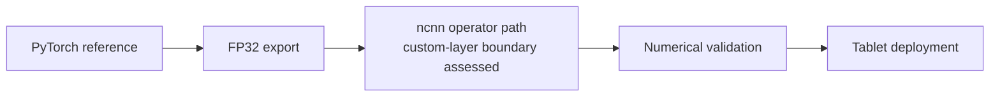

# SeedVR2-Style Adaptive-Window Attention on ncnn

[English](README.md) | [简体中文](README.zh-CN.md)

An edge inference prototype implementing SeedVR2-style adaptive-window attention on ncnn.

This repository validates an attention subsystem only. It is not a complete SeedVR2 inference implementation.

## Scope

### Completed

- BTHWC host dispatch by window, grid, and variant, including padding-validity masks, 3D RoPE inputs, window reconstruction, and crop.
- A staged four-head RMSNorm hybrid path, head merge, output projection, and model caching using standard ncnn operators.
- PyTorch FP32 fixture export and stage-level trace for raw QKV, Q/K normalization and RoPE, logits, probabilities, merge, and projection.
- Desktop Dynamic A/B/C validation against saved PyTorch fixtures; a fresh run passed the existing `1e-4` maximum-error gate.
- Android ARM64 CPU execution on a Xiaomi Pad 7 Pro. All three timing and memory runs completed; their BTHWC errors exceed the existing strict `1e-4` gate, so the tablet alignment result is recorded as **FAIL**.

### Not completed

- This is not full SeedVR2. The fixture uses C=32, four heads, head dimension 8; it does not restore an image or video with the official model.
- Dynamic A/B/C use deterministic synthetic weights, not the official SeedVR2 checkpoint.
- A custom `ncnn::Layer` is not implemented or required by this fixture; the runtime path uses standard ncnn operators.
- Direct flash_attn/apex fused-kernel parity is not validated.
- Android alignment has a measured cross-device difference above the current `1e-4` error limit. The cosine values and errors are retained without relaxing that limit.

Other phases in repository history are outside this portfolio entry. The results below describe only this attention fixture.

## Data flow



## Numerical alignment

The validator compares the complete final BTHWC output with the saved PyTorch FP32 reference generated by `tests/seedvr2_attention_fidelity/export_dynamic_rms_profile.py` (seed `20260805`). The tablet process ran one profile at a time. Its `FAIL` status reflects the existing maximum-error condition (`< 1e-4`), not a missing execution.

| Profile | Input BTHWC | Window / grid | Desktop cosine | Desktop max abs error | Tablet cosine | Tablet max abs error | Tablet gate |
| --- | --- | --- | ---: | ---: | ---: | ---: | --- |
| A | [1, 4, 8, 8, 32] | [4, 4, 4] / [1, 2, 2] | 1.0000000000 | 1.490116119e-7 | 0.9999988949 | 0.001141190529 | FAIL |
| B | [1, 4, 9, 10, 32] | [4, 4, 4] / [1, 3, 3] | 1.0000000000 | 1.490116119e-7 | 0.9999989426 | 0.001223027706 | FAIL |
| C | [1, 5, 9, 10, 32] | [4, 4, 4] / [2, 3, 3] | 1.0000000000 | 2.086162567e-7 | 0.9999989158 | 0.001506924629 | FAIL |

Reports: [desktop Dynamic A/B/C](reports/dynamic_rms_multi_shape_runtime_validation.json) and [tablet Dynamic A/B/C](reports/tablet_dynamic_rms_multi_shape_validation.json). The host A-profile stage trace is in [the hybrid report](reports/dynamic_rms_hybrid_runtime_validation.json).

## Performance

Each profile ran with three warm-ups and three measured iterations, one ncnn CPU thread, FP32, and Vulkan disabled. These are attention-path timings, not end-to-end image/video restoration time. Tablet memory is process `VmHWM` from `/proc/self/status`; Windows peak memory was not measured.

| Device / backend | Input BTHWC | Mean time | Peak process memory | Alignment |
| --- | --- | ---: | ---: | --- |
| Desktop x64 CPU, ncnn FP32 | [1, 4, 8, 8, 32] (A) | 1.105900 ms | 未测 | PASS |
| Desktop x64 CPU, ncnn FP32 | [1, 4, 9, 10, 32] (B) | 2.176000 ms | 未测 | PASS |
| Desktop x64 CPU, ncnn FP32 | [1, 5, 9, 10, 32] (C) | 3.324433 ms | 未测 | PASS |
| Xiaomi Pad 7 Pro, CPU FP32 | [1, 4, 8, 8, 32] (A) | 2.320486 ms | 54,056 kB | FAIL (`1e-4` max-error gate) |
| Xiaomi Pad 7 Pro, CPU FP32 | [1, 4, 9, 10, 32] (B) | 3.413993 ms | 54,680 kB | FAIL (`1e-4` max-error gate) |
| Xiaomi Pad 7 Pro, CPU FP32 | [1, 5, 9, 10, 32] (C) | 6.554219 ms | 54,632 kB | FAIL (`1e-4` max-error gate) |

## Tablet real-device run

- Device: Xiaomi Pad 7 Pro; `ro.product.model=24091RPADC`.
- SoC: device properties reported `ro.soc.model=SM8635` and `ro.board.platform=pineapple`; the About device screen labels it “Third-generation Snapdragon 8s Mobile Platform”.
- Android: 16; CPU ABI: `arm64-v8a`; `/proc/meminfo` `MemTotal`: 11,787,108 kB.
- Backend: ncnn CPU FP32, one thread, Vulkan disabled; ncnn source commit `a4d2ea1d4422`, NDK `26.3.11579264`, Android API 24.
- The verifier, fixtures, and JSON outputs were confined to `/data/local/tmp/seedvr2/`; that directory was removed after the reports were pulled.
- [04-tablet-run.png](demo-screenshots/04-tablet-run.png) is a crop of the device's About screen showing the device model and chipset. The three desktop terminal captures are [01 build](demo-screenshots/01-build.png), [02 alignment](demo-screenshots/02-alignment-result.png), and [03 desktop run](demo-screenshots/03-desktop-run.png); local absolute paths are excluded from the saved images.
- A linker warning was printed on each run: `normalize_path - invalid input: "D"`; the Android process still completed, and the full warning is retained in the tablet report.

## Build and run

### Desktop

Use Visual Studio 2022 Developer PowerShell on Windows. ncnn is an external checkout at commit `a4d2ea1d4422`; point `NCNN_SOURCE_DIR` to that existing source tree.

```powershell
$env:NCNN_SOURCE_DIR = Read-Host 'Path to existing ncnn source'
cmake -S $env:NCNN_SOURCE_DIR -B build/ncnn-cpu -DCMAKE_INSTALL_PREFIX="$PWD/build/ncnn-cpu/install" -DNCNN_VULKAN=OFF -DNCNN_BUILD_TESTS=OFF -DNCNN_BUILD_TOOLS=OFF -DNCNN_BUILD_EXAMPLES=OFF -DNCNN_SHARED_LIB=OFF
cmake --build build/ncnn-cpu --config Release --parallel 8
cmake --install build/ncnn-cpu --config Release

cmake -S tests/attention_dispatcher -B build/polish-portfolio-release -DCMAKE_PREFIX_PATH="$PWD/build/ncnn-cpu/install"
cmake --build build/polish-portfolio-release --target hybrid_runtime_validation dynamic_multi_shape_validation --config Release --parallel 8
```

Run the PyTorch reference stage check in an environment with PyTorch:

```powershell
python -m unittest discover -s tests/seedvr2_attention_fidelity -p test_phase8_2_reference_stages.py -v
```

Run A/B/C alignment and the warmed A-profile reference benchmark:

```powershell
$baseline = 'tests/attention_dispatcher/artifacts/attention_core'
$fidelity = 'tests/seedvr2_attention_fidelity/artifacts/attention_core_fidelity'
& build/polish-portfolio-release/Release/dynamic_multi_shape_validation.exe $baseline $fidelity
& build/polish-portfolio-release/Release/hybrid_runtime_validation.exe $baseline $fidelity dynamic_rms_rope3d_hybrid hybrid_dynamic_rms_rope444_grid_1x2x2
```

### Android ARM64 CPU

Set `$ndk` to an installed Android NDK and `$ncnnSource` to the same external ncnn checkout. This builds the verifier and CPU ncnn library; Vulkan stays off.

```powershell
$ndk = Read-Host 'Path to Android NDK'
$ncnnSource = Read-Host 'Path to existing ncnn source'
$ncnnBuild = 'build/ncnn-android-arm64'
$validatorBuild = 'build/attention-validator-android-arm64'

cmake -S $ncnnSource -B $ncnnBuild -G Ninja `
  -DCMAKE_TOOLCHAIN_FILE="$ndk/build/cmake/android.toolchain.cmake" `
  -DANDROID_ABI=arm64-v8a -DANDROID_PLATFORM=android-24 `
  -DCMAKE_BUILD_TYPE=Release -DCMAKE_INSTALL_PREFIX="$PWD/$ncnnBuild/install" `
  -DNCNN_DISABLE_EXCEPTION=OFF -DNCNN_VULKAN=OFF `
  -DNCNN_BUILD_TESTS=OFF -DNCNN_BUILD_TOOLS=OFF -DNCNN_BUILD_EXAMPLES=OFF
cmake --build $ncnnBuild --target install --parallel 8

cmake -S tests/attention_dispatcher -B $validatorBuild -G Ninja `
  -DCMAKE_TOOLCHAIN_FILE="$ndk/build/cmake/android.toolchain.cmake" `
  -DANDROID_ABI=arm64-v8a -DANDROID_PLATFORM=android-24 `
  -Dncnn_DIR="$PWD/$ncnnBuild/install/lib/cmake/ncnn"
cmake --build $validatorBuild --target dynamic_multi_shape_validation --parallel 8
```

With an authorized `adb devices` entry and the fixtures present on the host:

```powershell
$adb = 'adb'
$remote = '/data/local/tmp/seedvr2'
& $adb shell mkdir -p "$remote/artifacts"
& $adb push build/attention-validator-android-arm64/dynamic_multi_shape_validation "$remote/dynamic_multi_shape_validation"
& $adb push tests/attention_dispatcher/artifacts/attention_core "$remote/artifacts/attention_core"
& $adb push tests/seedvr2_attention_fidelity/artifacts/attention_core_fidelity "$remote/artifacts/attention_core_fidelity"
& $adb shell chmod +x "$remote/dynamic_multi_shape_validation"
foreach ($profile in 'A','B','C') {
  & $adb shell "$remote/dynamic_multi_shape_validation $remote/artifacts/attention_core $remote/artifacts/attention_core_fidelity $remote/tablet_$profile.json $profile"
}
& $adb shell rm -rf /data/local/tmp/seedvr2
```

The verifier performs three warm-ups followed by three timed iterations for each selected profile. It writes one JSON report per profile and reads peak RSS from `/proc/self/status` on Android.

## Screenshots

All four evidence images are in [demo-screenshots](demo-screenshots/README.md).
