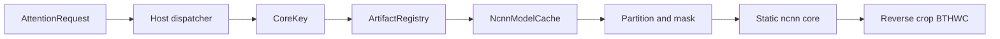

# SeedVR2 ncnn adaptive-window attention prototype

This is a SeedVR2-style adaptive-window attention prototype on [ncnn](https://github.com/Tencent/ncnn). It is not a full SeedVR2 video-restoration model. Desktop CPU FP32 fixtures in this tree match a saved PyTorch reference to about 1e-7 max absolute error, inside a 1e-4 acceptance gate. A later ARM64 tablet run on branch `polish-portfolio` (Xiaomi Pad 7 Pro, CPU FP32, one thread) measured about 1.1e-3 to 1.5e-3 on the same Dynamic A/B/C profiles and failed that gate. This snapshot does not repeat the device run.

## What this tree validates

Host code owns window dispatch, padding-validity masks, 3D RoPE inputs, and reverse crop. ncnn runs the attention math for registered static cores and a staged four-head hybrid path (Q/K LayerNorm or mathematical RMSNorm, local-window RoPE, host head merge, ncnn output projection, process-level model cache).



Baseline profiles: `[1,4,16,16,32]`, `[1,3,16,16,32]`, `[1,4,17,17,32]`, `[1,8,32,32,32]`, and `[1,5,19,21,32]`. Dynamic RMS hybrid shapes A/B/C are `[1,4,8,8,32]`, `[1,4,9,10,32]`, and `[1,5,9,10,32]`, with recorded max absolute errors `1.49012e-7`, `1.49012e-7`, and `2.08616e-7` ([current status](docs/CURRENT_STATUS.md)).

Phases 7.5-B through 9.5 are READY for that fixture scope. Phase 10 (synthetic `head_dim=128`) and everything after it live on other branches and are not part of this snapshot.

## Gap versus full SeedVR2

Upstream [SeedVR](https://github.com/ByteDance-Seed/SeedVR) / SeedVR2 is a one-step video restoration model: a VAE, a multi-block diffusion transformer, adaptive-window attention at production width (`head_dim` 128), and official checkpoints. This repository stops at a synthetic attention subsystem.

| | This prototype | Full SeedVR2 |
| --- | --- | --- |
| Task | Numeric attention fixture | Video restoration |
| Width | C=32, 4 heads, head_dim 8 | Production DiT width, head_dim 128 |
| Weights | Deterministic synthetic ncnn fixtures | Official checkpoints, not in git |
| Kernels | Standard ncnn operators | FlashAttention and Apex fused RMSNorm |
| Graph | Registered windows plus dynamic A/B/C | Arbitrary resolution, VAE, full DiT schedule |
| Devices | Desktop CPU FP32 validated here | GPU inference; tablet ARM on this fixture is a later branch and missed the 1e-4 gate |

Still out of scope here: real SeedVR2 weights, a complete DiT block, VAE, Vulkan, and direct fused-kernel parity. FP32 parity exports require `pnnx fp16=0`.

## Weights

Official SeedVR2 checkpoints are not in git and this prototype does not load them. The `.ncnn.param` / `.ncnn.bin` files under `tests/` are small synthetic fixtures committed so the numeric checks can run.

To fetch official weights for a separate experiment, use the upstream project and its published checkpoint repo. Phase notes on later branches identify Hugging Face [`ByteDance-Seed/SeedVR2-3B`](https://huggingface.co/ByteDance-Seed/SeedVR2-3B) (`seedvr2_ema_3b.pth` and `ema_vae.pth`). Keep those files outside git. Do not commit them.

```text
# example only; not required to build or test this prototype
huggingface-cli download ByteDance-Seed/SeedVR2-3B --local-dir /path/outside/git/seedvr2-3b
```

## Build

ncnn is pinned to commit `a4d2ea1d4422c9e849f166fd7a4aefb52f942f6a` (the CPU build recorded in [NCNN_BUILD_REPORT.md](NCNN_BUILD_REPORT.md)). CI uses the same commit.

```bash
git init -b ncnn-pin third_party/ncnn
git -C third_party/ncnn remote add origin https://github.com/Tencent/ncnn.git
git -C third_party/ncnn fetch --depth 1 origin a4d2ea1d4422c9e849f166fd7a4aefb52f942f6a
git -C third_party/ncnn checkout --detach FETCH_HEAD

cmake -S third_party/ncnn -B build/ncnn-cpu \
  -DCMAKE_BUILD_TYPE=Release \
  -DCMAKE_INSTALL_PREFIX="$PWD/build/ncnn-cpu/install" \
  -DNCNN_VULKAN=OFF -DNCNN_BUILD_TESTS=OFF \
  -DNCNN_BUILD_TOOLS=OFF -DNCNN_BUILD_EXAMPLES=OFF -DNCNN_BUILD_BENCHMARK=OFF
cmake --build build/ncnn-cpu --parallel
cmake --install build/ncnn-cpu

cmake -S tests/attention_dispatcher -B build/attention-dispatcher \
  -DCMAKE_BUILD_TYPE=Release \
  -DCMAKE_PREFIX_PATH="$PWD/build/ncnn-cpu/install"
cmake --build build/attention-dispatcher --parallel \
  --target runtime_validation dynamic_padding_mask_tests dynamic_rope3d_tests ncnn_mat_contract_tests
```

Pass `-DCMAKE_PREFIX_PATH` to any other test directory that calls `find_package(ncnn)`. There is no machine-local ncnn install path in the CMake files.

Host checks that do not link ncnn:

```bash
cmake -S tests/attention_dispatcher -B build/attention-host \
  -DCMAKE_BUILD_TYPE=Debug -DSEEDVR2_REQUIRE_NCNN=OFF
cmake --build build/attention-host --parallel \
  --target dynamic_padding_mask_tests dynamic_rope3d_tests \
          artifact_registry_tests dispatcher_tests hybrid_window_adapter_tests
./build/attention-host/dynamic_padding_mask_tests
./build/attention-host/dynamic_rope3d_tests
./build/attention-host/artifact_registry_tests
./build/attention-host/dispatcher_tests
./build/attention-host/hybrid_window_adapter_tests tests/seedvr2_attention_fidelity/artifacts/attention_core_fidelity
```

`runtime_validation` reads `tests/attention_dispatcher/artifacts/attention_core` and writes `reports/runtime_validation.json` plus `docs/runtime-validation-report.md`. Hybrid runs are described in [docs/hybrid-runtime-integration-report.md](docs/hybrid-runtime-integration-report.md) and [docs/rms-hybrid-runtime-report.md](docs/rms-hybrid-runtime-report.md).

GitHub Actions (`.github/workflows/cpu.yml`) builds this pinned ncnn and runs the host numeric tests plus `ncnn_mat_contract_tests`. It does not download weights.
