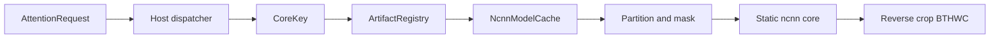

# SeedVR2 ncnn Adaptive Window Prototype

Metadata-driven Adaptive Window Attention runtime prototype for ncnn.

## Current status

Phase 7.5-B remains READY for five manifest-backed baseline FP32 CPU profiles
and the LayerNorm staged-hybrid fixture. Phase 8 mathematical RMSNorm is READY
for this fixture's complete ncnn attention-head accuracy gate. Phase 9.5
dynamic multi-shape RMS hybrid runtime is READY. Phase 10 head_dim=128 is READY:
the exact SeedVR2 MM-RoPE3D contract (rotary-embedding-torch==0.5.3, effective
rotary dim 126 of configured 128, 2-dim identity tail, axis_dims=[42,42,42])
was pinned, oracle-verified, and validated end-to-end (real-contract S/M/P),
with the Phase 10 synthetic fixture kept as an independent historical
regression. Phase 11 real single DiT block interface/shape contract is PARTIAL:
`NaMMSRTransformerBlock` and its call chain, token layout, `vid_freqs[l:l+f]`
RoPE offset, modulation, attention, MLP and residual order were extracted with
source/AST evidence, but the real random-weight forward probe is blocked by
missing non-model deps (einops/diffusers/flash_attn/apex/rotary-embedding-torch;
see [seedvr2-single-dit-block-contract-report.md](D:/AIProjects/seedvr2-ncnn/docs/seedvr2-single-dit-block-contract-report.md)).
This is not a complete SeedVR2 port.



Supported profiles: `[1,4,16,16,32]`, `[1,3,16,16,32]`, `[1,4,17,17,32]`,
`[1,8,32,32,32]`, `[1,5,19,21,32]`, Dynamic A/B/C `[1,4,8,8,32]` /
`[1,4,9,10,32]` / `[1,5,9,10,32]`, and synthetic/real-contract HD128 S/M/P `[1,4,4,4,512]` /
`[1,4,8,8,512]` / `[1,5,9,10,512]`.

## Build and validate

Configure a Release Ninja build of `tests/attention_dispatcher`, then build
`model_cache_tests` and `runtime_validation`. Run:

```text
runtime_validation tests/attention_dispatcher/artifacts/attention_core
```

It writes [runtime_validation.json](D:\AIProjects\seedvr2-ncnn\reports\runtime_validation.json) and
[runtime-validation-report.md](D:\AIProjects\seedvr2-ncnn\docs\runtime-validation-report.md).

Phase 10 synthetic HD128 validation:

```text
synthetic_hd128_validation tests/seedvr2_attention_fidelity/artifacts/attention_core_fidelity reports/phase10_regression_inputs.txt
```

It writes [synthetic_hd128_runtime_validation.json](D:\AIProjects\seedvr2-ncnn\reports\synthetic_hd128_runtime_validation.json) and is documented in
[synthetic-hd128-runtime-report.md](D:\AIProjects\seedvr2-ncnn\docs\synthetic-hd128-runtime-report.md).

Phase 10.1 real SeedVR2 MM-RoPE3D contract validation (new clean build `build/phase10_1-real-mmrope-release`):

```text
real_mmrope_contract_validation tests/seedvr2_attention_fidelity/artifacts/attention_core_fidelity reports/phase10_regression_inputs.txt
```

It writes [real_seedvr2_mmrope_contract_validation.json](D:\AIProjects\seedvr2-ncnn\reports\real_seedvr2_mmrope_contract_validation.json) and is documented in
[real-seedvr2-mmrope-contract-report.md](D:\AIProjects\seedvr2-ncnn\docs\real-seedvr2-mmrope-contract-report.md).

Phase 11 real single DiT block contract probe (Python, no ncnn build needed):

```text
D:\AIProjects\seedvr2-ncnn\.conda-cuda\python.exe tests\seedvr2_dit_block_contract\extract_seedvr2_block_contract.py
```

It writes [seedvr2_single_dit_block_contract.json](D:\AIProjects\seedvr2-ncnn\reports\seedvr2_single_dit_block_contract.json),
`tests/seedvr2_dit_block_contract/seedvr2_block_contract.json`, and is
documented in [seedvr2-single-dit-block-contract-report.md](D:\AIProjects\seedvr2-ncnn\docs\seedvr2-single-dit-block-contract-report.md).

## Limits

Only the registered profiles are supported; arbitrary resolutions require a
matching static core. The hybrid fidelity fixture supplies artifact-owned mask
and RoPE data and is documented in
[hybrid-runtime-integration-report.md](D:\AIProjects\seedvr2-ncnn\docs\hybrid-runtime-integration-report.md).
Host code owns dynamic control flow, while ncnn executes the attention math.
Vulkan, SeedVR2 weight loading, generalized runtime validation, and direct
Apex `fusedrms` dependency parity remain out of scope or blocked as documented
in [rms-hybrid-runtime-report.md](D:\AIProjects\seedvr2-ncnn\docs\rms-hybrid-runtime-report.md).

## Phase 9.4 status

`Phase 9.4 metadata/runtime routing = READY`. Fixed LayerNorm and RMSNorm use
artifact-owned mask/RoPE inputs; Dynamic A uses generated padding-validity mask
and dynamic MM-RoPE3D with natural `valid_tokens=64`. Any public C++ type-layout
change requires a new clean build directory. `Phase 9 multi-shape validation =
PARTIAL` until Dynamic B/C are implemented.

## Current result

This is a metadata-driven, SeedVR2-style adaptive-window attention subsystem for ncnn, not complete SeedVR2 inference. It includes baseline single-model execution; staged four-head Hybrid execution; Q/K LayerNorm and mathematical RMSNorm; local-window 3D RoPE; dynamic padding-validity masks; host head merge; ncnn projection; process-level model cache; variant-aware artifacts; Dynamic A/B/C FP32 CPU parity around `1e-7`; and a head_dim=128 fixture (S/M/P) under both the documented synthetic contract and the real SeedVR2 MM-RoPE3D contract (rotary-embedding-torch 0.5.3) with sub-`1e-6` RoPE parity, sub-`1e-4` stage parity, and exact validity/mask agreement.

All FP32 parity/reference artifacts must use `pnnx fp16=0`. After public C++ type-layout changes (for example `CoreInfo` or `std::variant` payloads), use a new clean build directory and rebuild all dependent targets.

Phase 7.5-B LayerNorm Hybrid Runtime = READY; Phase 8 RMSNorm Hybrid Runtime = READY; Phase 8.1 FP32 conversion precision fix = READY; Phase 9.1 DynamicAttentionContract = READY; Phase 9.2 Dynamic padding mask = READY; Phase 9.3 Dynamic MM-RoPE3D = READY; Phase 9.4 Typed auxiliary metadata/runtime routing = READY; Phase 9.5 Dynamic multi-shape RMS Hybrid Runtime = READY; Phase 10 head_dim=128 = READY (real SeedVR2 MM-RoPE3D contract confirmed from rotary-embedding-torch==0.5.3 and validated; synthetic contract kept as historical regression).

TODO: integrate the real DiT block (video T-axis text-length offset l, text token RoPE), real SeedVR2 weights, profiles beyond A/B/C/HD128, Vulkan, VAE/full video restoration, and direct Apex fused-RMSNorm parity.
