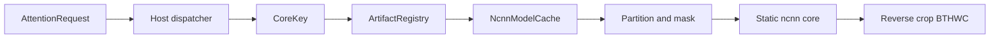

# SeedVR2 ncnn Adaptive Window Prototype

[English](README.md) | [简体中文](README.zh-CN.md)

Metadata-driven Adaptive Window Attention runtime prototype for ncnn.

## Current status

Phase 7.5-B remains READY for five manifest-backed baseline FP32 CPU profiles
and the LayerNorm staged-hybrid fixture. Phase 8 mathematical RMSNorm is READY
for this fixture's complete ncnn attention-head accuracy gate. Phase 9.5
dynamic multi-shape RMS hybrid runtime is READY. Phase 10 head_dim=128 is READY:
the exact SeedVR2 MM-RoPE3D contract (rotary-embedding-torch==0.5.3, effective
rotary dim 126 of configured 128, 2-dim identity tail, axis_dims=[42,42,42])
was pinned, oracle-verified, and validated end-to-end (real-contract S/M/P),
with the Phase 10 synthetic fixture kept as an independent historical
regression. Phase 11 real single DiT block interface/shape/execution contract is
READY (superseded by Phase 12 staged ncnn fidelity): `NaMMSRTransformerBlock` (SeedVR2 `e4de8c2`) was executed with the real
random-weight forward in the isolated conda env `seedvr2-block-probe` (torch
2.4.0+cpu, einops 0.7.0, diffusers 0.33.1, rotary-embedding-torch 0.5.3) at full
2560 width (profiles A/B/C/D) with runtime-hook evidence for `[vid_win; txt]`
packing, `vid_freqs[l:l+f]` offset, identity tail 2, six-segment modulation,
SwiGLU, residual order, last-layer vid_only, window reassembly, negatives 17/17;
only flash_attn/apex fused-CUDA libs are replaced by test-harness CPU compat
(parity < 1e-6; CUDA fidelity not validated). See
[seedvr2-single-dit-block-contract-report.md](D:/AIProjects/seedvr2-ncnn/docs/seedvr2-single-dit-block-contract-report.md).
Phase 12 synthetic single DiT block staged ncnn fidelity is READY: the real
`NaMMSRTransformerBlock` topology runs at scaled C=512/H=4/HD=128 through a
staged ncnn + host hybrid runtime (`HybridDiTBlockRuntime`, seed 20260802, MLP
hidden 1536 from the real SwiGLUMLP formula); profiles A/B/C/D all PASS with
final vid/txt < 1e-4, A->B->C->D->A bit-identical, last-layer vid_only PASS,
registry/cache 19, negatives 24+7+registry, and Phase 9.5/10/11 regressions
PASS (batch>1 txt indexing quirk of the real `repeat_concat_idx` reproduced
exactly). See [synthetic-seedvr2-dit-block-ncnn-report.md](D:/AIProjects/seedvr2-ncnn/docs/synthetic-seedvr2-dit-block-ncnn-report.md).
Phase 13 real-width single-block feasibility + weight mapping is READY: the real
`NaMMSRTransformerBlock` at C=2560/H=20/HD=128 (MLP 6912, seed 20260803, random
weights) is exported to 19 FP32 ncnn stage models (`pnnx fp16=0`) and passes the
minimal RW-A profile end-to-end on the existing `HybridDiTBlockRuntime`
(final vid/txt ~1e-5, bit-identical determinism, cache 19, peak working set
~685 MB, cached forward ~31 ms), with a full committed state_dict->ncnn weight
mapping contract (29/29, AdaSingle runtime-only, qk-norm all-ones folded,
last-layer reuses all 19 models). See
[realwidth-seedvr2-block-feasibility-report.md](D:/AIProjects/seedvr2-ncnn/docs/realwidth-seedvr2-block-feasibility-report.md)
and [seedvr2-block-weight-mapping-report.md](D:/AIProjects/seedvr2-ncnn/docs/seedvr2-block-weight-mapping-report.md).
Phase 14 real-weight single-block hybrid visual milestone is **READY**: the
official `ByteDance-Seed/SeedVR2-3B` checkpoint (5/5 sha256 verified, official
source only) is safely loaded (`weights_only=True`), schema-validated (32 blocks,
block 16 = floor(32/2) middle, 635 fp32 keys), q/k RMSNorm forced real-affine
(not all-ones; Phase 13 0-byte reuse forbidden), mapped via the 15-key
state_dict->ncnn contract (mapped_numel == source_numel, QKV/SwiGLU bit-exact),
exported to 19 FP32 stages (`pnnx fp16=0`, git-ignored `.phase14_local_artifacts/`),
and the ncnn `HybridDiTBlockRuntime` with real weights passes the RW-A O(1)
fixture (final vid/txt < 2e-4) and the official-context block-16 parity
(rel < 1e-3), plus a hybrid visual milestone: 4-frame 128x128 official pipeline
with one block replaced by ncnn, pixel PSNR 52.5 dB / SSIM 0.9975, adapter
evidence (ncnn=1, original=0, no silent fallback), negatives 29/29, regressions
22/22. See [real-weight-single-block-report.md](D:/AIProjects/seedvr2-ncnn/docs/real-weight-single-block-report.md)
and [hybrid-visual-milestone-report.md](D:/AIProjects/seedvr2-ncnn/docs/hybrid-visual-milestone-report.md).
Phase 15 real-weight multi-block streaming hybrid is **READY**: blocks
15/16/17/18 of the official `ByteDance-Seed/SeedVR2-3B` checkpoint run through
ncnn in strict streaming mode (`LOAD -> EXECUTE -> UNLOAD` per block; runtime
destroyed, model cache cleared to 0, resident bytes 0, file handles released;
`max_resident_weighted_blocks=1` always). Chain parity (streaming == resident,
fresh clean build `build/phase15-multiblock-release`) PASS: chain_1 rel
8.872e-9 (limit 1e-3), chain_2 2.835e-6 (2e-3), chain_4 3.777e-6 (5e-3),
NaN/Inf=0; official-pipeline visual with 1/2/4 blocks swapped: pixel PSNR
53.65/52.72/52.90 dB (>=38), SSIM 0.9978/0.9978/0.9977 (>=0.98), per-block
parity 1.8e-8..3.8e-6 (limit 1e-3), adapter evidence per block
(ncnn=1 / original=0 / silent_fallback=false); memory profile: streaming peak
flat 474/496/476 MB vs resident linear 446/839/1530 MB (per-block streaming is
the required 32-block strategy); negatives 48/48; regressions 27/27; git
protection PASS. See [multiblock-streaming-hybrid-report.md](D:/AIProjects/seedvr2-ncnn/docs/multiblock-streaming-hybrid-report.md)
and [multiblock-error-growth-report.md](D:/AIProjects/seedvr2-ncnn/docs/multiblock-error-growth-report.md).

Phase 16 full SeedVR2 DiT streaming is **READY**: all 32 real blocks 0..31
(including the unique last layer 31) run through ncnn in strict per-block
streaming mode (`LOAD -> EXECUTE -> UNLOAD`, `max_resident_weighted_blocks=1`;
per block the runtime is destroyed, the model cache cleared to 0, resident
bytes 0, and artifact file rename-probes pass). Blocks 0..9 use the split
29-key layout, blocks 10..31 the shared 15-key `.all.` layout - both derived
from the checkpoint, never hardcoded. All 32/32 artifacts verified
(`reports/phase16_artifact_inventory.json`, logical 13.32 GB with physical
dedup; blocks 15-18 hardlink-reused from Phase 15). Chain parity
(streaming == FP32 reference, fresh build `build/phase16-full-dit-release`):
chain_8 rel 5.6465e-4 (limit 1e-2), chain_16 2.0992e-3 (2e-2), chain_full
5.0234e-3 (5e-2), NaN/Inf=0, 3x bit-identical; last-layer standalone parity
combined rel 4.05e-6 (limit 1e-3). Official-pipeline visual with 8/16/all-32
blocks swapped to ONE strict ncnn adapter call per run: pixel PSNR
51.336/52.551/51.050 dB (>=34), SSIM 0.9974/0.9976/0.9972 (>=0.95), adapter
evidence ncnn=8/16/32, original=0, silent_fallback=false,
`max_resident_weighted_blocks=1`; negatives 80/80; regressions 27/27; git
protection PASS. See [full-dit-streaming-report.md](D:/AIProjects/seedvr2-ncnn/docs/full-dit-streaming-report.md)
and [full-dit-error-growth-report.md](D:/AIProjects/seedvr2-ncnn/docs/full-dit-error-growth-report.md).

Phase 17 real-weight SeedVR2 VAE-in-ncnn + full video restoration is **READY**:
the official `ema_vae.pth` (sha256 `c7df8a67...`, 250 fp32 tensors,
250,648,227 numel, Phase 14 download 5/5 verified) is exported as 14 FP32 ncnn
stage chains (7 encoder + 7 decoder, `pnnx fp16=0`, profiles A/B). Stage parity
14/14 (rel max ~2.1e-6); encoder parity A 2.166e-6 / B 1.897e-6; decoder parity
A/B rel 2.08e-5 / 1.73e-5 with PNG PSNR 117.9 / 119.3 dB and SSIM 1.0; full-VAE
roundtrip A/B pixel PSNR ~116.7 / 117.8 dB, SSIM 1.0, ncnn encoder 7 / decoder
14 calls, no silent fallback; weight mapping 250/250 (mapped_numel ==
source_numel); tiling / streaming-lifecycle / latency / memory / IO contracts
PASS; negatives 70/70; regressions PASS. Official-pipeline full video
restoration (4 frames 128x128, seed 20260803, steps 1, cfg 1.0, scheduler/host
conditioning stays PyTorch): `full_ncnn_core` (ncnn VAE encode + 32-block ncnn
DiT + ncnn VAE decode) pixel PSNR 51.195 dB (>=40) / SSIM 0.9990 (>=0.98),
latent RMSE 0.0206, NaN/Inf=0; `dit_ncnn_vae_pytorch` 51.998 dB / 0.9989;
`dit_ncnn_decoder_ncnn` 52.105 dB / 0.9990; adapter evidence ncnn encoder=1 /
decoder=1 / original=0 / silent_fallback=false / max_resident_weighted_dit_blocks=1.
See [vae-ncnn-full-video-restoration-report.md](D:/AIProjects/seedvr2-ncnn/docs/vae-ncnn-full-video-restoration-report.md).

This is a SeedVR2-style attention subsystem with a single-block, small
multi-block (1/2/4), and full 32-block (8/16/all) streaming ncnn runtime,
not a complete SeedVR2 port.



Supported profiles: `[1,4,16,16,32]`, `[1,3,16,16,32]`, `[1,4,17,17,32]`,
`[1,8,32,32,32]`, `[1,5,19,21,32]`, Dynamic A/B/C `[1,4,8,8,32]` /
`[1,4,9,10,32]` / `[1,5,9,10,32]`, and synthetic/real-contract HD128 S/M/P `[1,4,4,4,512]` /
`[1,4,8,8,512]` / `[1,5,9,10,512]`.

## Build and validate

Configure a Release Ninja build of `tests/attention_dispatcher`, then build
`model_cache_tests` and `runtime_validation`. Run:

```text
runtime_validation tests/attention_dispatcher/artifacts/attention_core
```

It writes [runtime_validation.json](D:\AIProjects\seedvr2-ncnn\reports\runtime_validation.json) and
[runtime-validation-report.md](D:\AIProjects\seedvr2-ncnn\docs\runtime-validation-report.md).

Phase 10 synthetic HD128 validation:

```text
synthetic_hd128_validation tests/seedvr2_attention_fidelity/artifacts/attention_core_fidelity reports/phase10_regression_inputs.txt
```

It writes [synthetic_hd128_runtime_validation.json](D:\AIProjects\seedvr2-ncnn\reports\synthetic_hd128_runtime_validation.json) and is documented in
[synthetic-hd128-runtime-report.md](D:\AIProjects\seedvr2-ncnn\docs\synthetic-hd128-runtime-report.md).

Phase 10.1 real SeedVR2 MM-RoPE3D contract validation (new clean build `build/phase10_1-real-mmrope-release`):

```text
real_mmrope_contract_validation tests/seedvr2_attention_fidelity/artifacts/attention_core_fidelity reports/phase10_regression_inputs.txt
```

It writes [real_seedvr2_mmrope_contract_validation.json](D:\AIProjects\seedvr2-ncnn\reports\real_seedvr2_mmrope_contract_validation.json) and is documented in
[real-seedvr2-mmrope-contract-report.md](D:\AIProjects\seedvr2-ncnn\docs\real-seedvr2-mmrope-contract-report.md).

Phase 11 real single DiT block contract: extraction (source/AST, no ncnn build
needed) and Phase 11.1 real random-weight forward execution:

```text
D:\AIProjects\seedvr2-ncnn\.conda-cuda\python.exe tests\seedvr2_dit_block_contract\extract_seedvr2_block_contract.py
conda run -n seedvr2-block-probe python tests\seedvr2_dit_block_contract\probe_real_block.py
conda run -n seedvr2-block-probe python run_phase11_1_probe.py
```

`probe_real_block.py` runs the three suites in-process and writes
`tests/seedvr2_dit_block_contract/probe_result.json` (PASS). The runner
`run_phase11_1_probe.py` executes the three test files as subprocesses and
writes [seedvr2_real_block_forward.json](D:\AIProjects\seedvr2-ncnn\reports\seedvr2_real_block_forward.json).
Extraction writes [seedvr2_single_dit_block_contract.json](D:\AIProjects\seedvr2-ncnn\reports\seedvr2_single_dit_block_contract.json)
and `tests/seedvr2_dit_block_contract/seedvr2_block_contract.json`. Documented
in [seedvr2-single-dit-block-contract-report.md](D:\AIProjects\seedvr2-ncnn\docs\seedvr2-single-dit-block-contract-report.md).

## Limits

Only the registered profiles are supported; arbitrary resolutions require a
matching static core. The hybrid fidelity fixture supplies artifact-owned mask
and RoPE data and is documented in
[hybrid-runtime-integration-report.md](D:\AIProjects\seedvr2-ncnn\docs\hybrid-runtime-integration-report.md).
Host code owns dynamic control flow, while ncnn executes the attention math.
Vulkan, SeedVR2 weight loading, generalized runtime validation, and direct
Apex `fusedrms` dependency parity remain out of scope or blocked as documented
in [rms-hybrid-runtime-report.md](D:\AIProjects\seedvr2-ncnn\docs\rms-hybrid-runtime-report.md).

## Phase 9.4 status

`Phase 9.4 metadata/runtime routing = READY`. Fixed LayerNorm and RMSNorm use
artifact-owned mask/RoPE inputs; Dynamic A uses generated padding-validity mask
and dynamic MM-RoPE3D with natural `valid_tokens=64`. Any public C++ type-layout
change requires a new clean build directory. `Phase 9 multi-shape validation =
PARTIAL` until Dynamic B/C are implemented.

## Current result

This is a metadata-driven, SeedVR2-style adaptive-window attention subsystem for ncnn, not complete SeedVR2 inference. It includes baseline single-model execution; staged four-head Hybrid execution; Q/K LayerNorm and mathematical RMSNorm; local-window 3D RoPE; dynamic padding-validity masks; host head merge; ncnn projection; process-level model cache; variant-aware artifacts; Dynamic A/B/C FP32 CPU parity around `1e-7`; and a head_dim=128 fixture (S/M/P) under both the documented synthetic contract and the real SeedVR2 MM-RoPE3D contract (rotary-embedding-torch 0.5.3) with sub-`1e-6` RoPE parity, sub-`1e-4` stage parity, and exact validity/mask agreement.

All FP32 parity/reference artifacts must use `pnnx fp16=0`. After public C++ type-layout changes (for example `CoreInfo` or `std::variant` payloads), use a new clean build directory and rebuild all dependent targets.

Phase 7.5-B LayerNorm Hybrid Runtime = READY; Phase 8 RMSNorm Hybrid Runtime = READY; Phase 8.1 FP32 conversion precision fix = READY; Phase 9.1 DynamicAttentionContract = READY; Phase 9.2 Dynamic padding mask = READY; Phase 9.3 Dynamic MM-RoPE3D = READY; Phase 9.4 Typed auxiliary metadata/runtime routing = READY; Phase 9.5 Dynamic multi-shape RMS Hybrid Runtime = READY; Phase 10 head_dim=128 = READY (real SeedVR2 MM-RoPE3D contract confirmed from rotary-embedding-torch==0.5.3 and validated; synthetic contract kept as historical regression).

Phase 14 = READY (real SeedVR2 3B checkpoint, real-weight single-block hybrid visual milestone; see reports above).

Phase 13 real-width validation (clean build `build/phase13-real-width-release`):

```text
build/phase13-real-width-release/realwidth_dit_block_validation.exe .phase13_local_artifacts reports/realwidth_seedvr2_block_feasibility.json
build/phase13-real-width-release/realwidth_artifact_inventory_tests.exe .phase13_local_artifacts reports/realwidth_artifact_inventory.json
conda run -n seedvr2-block-probe python tests/seedvr2_weight_mapping/aggregate_realwidth_feasibility.py
```

Heavy real-width artifacts stay in the git-ignored `.phase13_local_artifacts/`
directory; only manifests, the mapping contract, scripts, tests and reports are
committed (see `tests/seedvr2_weight_mapping/check_no_large_tracked_artifacts.py`).

TODO (Phase 18, not started - explicit authorization required): Android/Vulkan
targets (Pad 7 Pro NOT validated), direct fused-kernel parity (flash_attn/apex),
and full_pure_ncnn_application (scheduler/timestep/conditioning in ncnn). Phase 17
committed evidence: real-weight VAE-in-ncnn full video restoration - full_ncnn_core
pixel PSNR 51.195 dB / SSIM 0.9990 (>=40 / >=0.98), latent RMSE 0.0206, stage
parity 14/14 rel <=2.1e-6, encoder/decoder parity rel 1.9e-6 / 1.7e-5, negatives
70/70, regressions PASS, git protection PASS.
# Phase 18A Android ARM64 scaffold

Phase 18A is **READY_FOR_DEVICE** on `phase18a-android-arm64-scaffold`; full Phase 18 is **NOT READY**. The device-free [`android/`](android/) project builds Debug and unsigned Release APKs containing only AArch64 `libseededge.so`, with pinned ncnn/Vulkan source integration, five JSON JNI endpoints, a deterministic synthetic CPU test, and an external model-manifest contract. No Xiaomi Pad, Android runtime, Vulkan inference, VAE/DiT, or full restoration execution occurred. See [`docs/android-phase18a-build-and-scaffold-report.md`](docs/android-phase18a-build-and-scaffold-report.md).
# Phase 18B Find X8 runtime update

Temporary PKB110 (Android 16/API 36, arm64-v8a) runtime validation is PASS: CPU FP32 synthetic 20/20, real ncnn Vulkan upload/inference/download 10/10 on Mali-G925-Immortalis MC12, CPU/Vulkan max error 0, no fallback, final FATAL/native crash count 0. This does not replace Xiaomi Pad 7 Pro final validation; complete Phase 18 is NOT READY. See `docs/android-phase18b-findx8-runtime-validation.md`.
