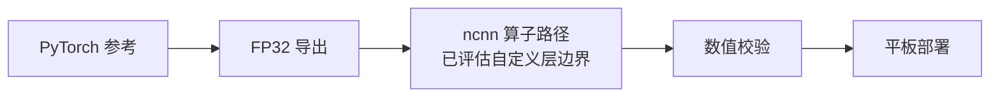

# SeedVR2 ncnn 自适应窗口注意力原型

[English](README.md) | [简体中文](README.zh-CN.md)

在 ncnn 上实现 SeedVR2 风格 adaptive-window attention 的端侧推理原型。

该仓库验证的是注意力子系统，不是完整 SeedVR2 推理。

## 范围

### 已完成

- 按 window、grid、variant 对 BTHWC 输入做 host dispatch，支持 padding-validity mask、3D RoPE 输入、窗口恢复与裁剪。
- 使用 ncnn 标准算子实现分阶段四头 RMSNorm hybrid 路径、头合并、输出投影和模型缓存。
- 导出 PyTorch FP32 参考夹具，并追踪原始 QKV、Q/K 归一化与 RoPE、logits、probabilities、头合并及投影阶段。
- 桌面 Dynamic A/B/C 对照 PyTorch fixture；最近一次运行通过既有 `1e-4` 最大误差门槛。
- Xiaomi Pad 7 Pro 上以 Android ARM64 CPU 实际运行。三个 profile 的耗时和内存均已采集；BTHWC 数值误差超过既有 `1e-4` 门槛，因此平板对齐状态记录为 **FAIL**。

### 尚未完成

- 这不是完整 SeedVR2。夹具为 C=32、4 heads、head_dim=8；没有用官方模型完成图片或视频修复。
- Dynamic A/B/C 使用确定性合成权重，不是官方 SeedVR2 checkpoint。
- 没有实现自定义 `ncnn::Layer`；本 fixture 使用 ncnn 标准算子，也不需要自定义层。
- flash_attn/apex 融合内核直接 parity 尚未验证。
- 平板端与参考实现的最大误差高于当前 `1e-4` 限制；保留实测 cosine 与误差，未放宽限制。

仓库历史中的其他阶段不属于本作品集条目。下文数据只描述这个注意力 fixture。

## 数据流



## 数值对齐

验证器将完整最终 BTHWC 输出与已保存的 PyTorch FP32 参考对比。参考张量由 `tests/seedvr2_attention_fidelity/export_dynamic_rms_profile.py` 生成，seed 为 `20260805`。平板上每个 profile 独立运行一次；`FAIL` 表示当前最大误差条件（`< 1e-4`）未通过，不代表没有运行。

| Profile | 输入 BTHWC | Window / grid | 桌面 cosine | 桌面最大绝对误差 | 平板 cosine | 平板最大绝对误差 | 平板门槛 |
| --- | --- | --- | ---: | ---: | ---: | ---: | --- |
| A | [1, 4, 8, 8, 32] | [4, 4, 4] / [1, 2, 2] | 1.0000000000 | 1.490116119e-7 | 0.9999988949 | 0.001141190529 | FAIL |
| B | [1, 4, 9, 10, 32] | [4, 4, 4] / [1, 3, 3] | 1.0000000000 | 1.490116119e-7 | 0.9999989426 | 0.001223027706 | FAIL |
| C | [1, 5, 9, 10, 32] | [4, 4, 4] / [2, 3, 3] | 1.0000000000 | 2.086162567e-7 | 0.9999989158 | 0.001506924629 | FAIL |

报告：[桌面 Dynamic A/B/C](reports/dynamic_rms_multi_shape_runtime_validation.json)、[平板 Dynamic A/B/C](reports/tablet_dynamic_rms_multi_shape_validation.json)。桌面 A profile 分阶段参考见[hybrid 报告](reports/dynamic_rms_hybrid_runtime_validation.json)。

## 性能

每个 profile 预热 3 次、计时 3 次；ncnn CPU 单线程、FP32、关闭 Vulkan。这里统计注意力路径，不是图片/视频端到端修复时间。平板峰值内存取自 `/proc/self/status` 的进程 `VmHWM`；Windows 桌面峰值内存未测。

| 设备 / 后端 | 输入 BTHWC | 平均耗时 | 进程峰值内存 | 对齐状态 |
| --- | --- | ---: | ---: | --- |
| 桌面 x64 CPU，ncnn FP32 | [1, 4, 8, 8, 32] (A) | 1.105900 ms | 未测 | PASS |
| 桌面 x64 CPU，ncnn FP32 | [1, 4, 9, 10, 32] (B) | 2.176000 ms | 未测 | PASS |
| 桌面 x64 CPU，ncnn FP32 | [1, 5, 9, 10, 32] (C) | 3.324433 ms | 未测 | PASS |
| Xiaomi Pad 7 Pro，CPU FP32 | [1, 4, 8, 8, 32] (A) | 2.320486 ms | 54,056 kB | FAIL（最大误差门槛 `1e-4`）|
| Xiaomi Pad 7 Pro，CPU FP32 | [1, 4, 9, 10, 32] (B) | 3.413993 ms | 54,680 kB | FAIL（最大误差门槛 `1e-4`）|
| Xiaomi Pad 7 Pro，CPU FP32 | [1, 5, 9, 10, 32] (C) | 6.554219 ms | 54,632 kB | FAIL（最大误差门槛 `1e-4`）|

## 平板实测

- 设备：Xiaomi Pad 7 Pro；`ro.product.model=24091RPADC`。
- 芯片：设备属性报告 `ro.soc.model=SM8635`、`ro.board.platform=pineapple`；设备信息页标注“第三代骁龙 8s 移动平台”。
- Android：16；CPU ABI：`arm64-v8a`；`/proc/meminfo` 的 `MemTotal` 为 11,787,108 kB。
- 后端：ncnn CPU FP32、单线程、关闭 Vulkan；ncnn 源码 commit `a4d2ea1d4422`，NDK `26.3.11579264`，Android API 24。
- 验证器、fixture 和 JSON 输出只放在 `/data/local/tmp/seedvr2/`；拉回报告后已删除该目录。
- [04-tablet-run.png](demo-screenshots/04-tablet-run.png) 是平板“关于设备”页截图裁剪，展示机型和芯片。三张桌面终端留证分别为 [01 编译](demo-screenshots/01-build.png)、[02 对齐](demo-screenshots/02-alignment-result.png)、[03 桌面运行](demo-screenshots/03-desktop-run.png)；保存的图片不含本机绝对路径。
- 每次运行都输出 linker 警告 `normalize_path - invalid input: "D"`，但验证器仍完成运行；完整警告保存在平板 JSON 报告中。

## 编译与运行

### 桌面

Windows 使用 Visual Studio 2022 Developer PowerShell。ncnn 源码位于仓库外部，使用已有 commit `a4d2ea1d4422` checkout，并设置 `NCNN_SOURCE_DIR`。

```powershell
$env:NCNN_SOURCE_DIR = Read-Host '输入已有 ncnn 源码目录'
cmake -S $env:NCNN_SOURCE_DIR -B build/ncnn-cpu -DCMAKE_INSTALL_PREFIX="$PWD/build/ncnn-cpu/install" -DNCNN_VULKAN=OFF -DNCNN_BUILD_TESTS=OFF -DNCNN_BUILD_TOOLS=OFF -DNCNN_BUILD_EXAMPLES=OFF -DNCNN_SHARED_LIB=OFF
cmake --build build/ncnn-cpu --config Release --parallel 8
cmake --install build/ncnn-cpu --config Release

cmake -S tests/attention_dispatcher -B build/polish-portfolio-release -DCMAKE_PREFIX_PATH="$PWD/build/ncnn-cpu/install"
cmake --build build/polish-portfolio-release --target hybrid_runtime_validation dynamic_multi_shape_validation --config Release --parallel 8
```

在有 PyTorch 的 Python 环境中检查参考阶段：

```powershell
python -m unittest discover -s tests/seedvr2_attention_fidelity -p test_phase8_2_reference_stages.py -v
```

运行 A/B/C 对齐和预热后的 A profile 参考性能：

```powershell
$baseline = 'tests/attention_dispatcher/artifacts/attention_core'
$fidelity = 'tests/seedvr2_attention_fidelity/artifacts/attention_core_fidelity'
& build/polish-portfolio-release/Release/dynamic_multi_shape_validation.exe $baseline $fidelity
& build/polish-portfolio-release/Release/hybrid_runtime_validation.exe $baseline $fidelity dynamic_rms_rope3d_hybrid hybrid_dynamic_rms_rope444_grid_1x2x2
```

### Android ARM64 CPU

将 `$ndk` 设为 Android NDK 路径，`$ncnnSource` 设为已有 ncnn 源码目录。下列步骤构建 CPU ncnn 和验证器，关闭 Vulkan。

```powershell
$ndk = Read-Host 'Android NDK 路径'
$ncnnSource = Read-Host '已有 ncnn 源码目录'
$ncnnBuild = 'build/ncnn-android-arm64'
$validatorBuild = 'build/attention-validator-android-arm64'

cmake -S $ncnnSource -B $ncnnBuild -G Ninja `
  -DCMAKE_TOOLCHAIN_FILE="$ndk/build/cmake/android.toolchain.cmake" `
  -DANDROID_ABI=arm64-v8a -DANDROID_PLATFORM=android-24 `
  -DCMAKE_BUILD_TYPE=Release -DCMAKE_INSTALL_PREFIX="$PWD/$ncnnBuild/install" `
  -DNCNN_DISABLE_EXCEPTION=OFF -DNCNN_VULKAN=OFF `
  -DNCNN_BUILD_TESTS=OFF -DNCNN_BUILD_TOOLS=OFF -DNCNN_BUILD_EXAMPLES=OFF
cmake --build $ncnnBuild --target install --parallel 8

cmake -S tests/attention_dispatcher -B $validatorBuild -G Ninja `
  -DCMAKE_TOOLCHAIN_FILE="$ndk/build/cmake/android.toolchain.cmake" `
  -DANDROID_ABI=arm64-v8a -DANDROID_PLATFORM=android-24 `
  -Dncnn_DIR="$PWD/$ncnnBuild/install/lib/cmake/ncnn"
cmake --build $validatorBuild --target dynamic_multi_shape_validation --parallel 8
```

在 `adb devices` 显示已授权设备后，推送 fixture 并逐个 profile 运行：

```powershell
$adb = 'adb'
$remote = '/data/local/tmp/seedvr2'
& $adb shell mkdir -p "$remote/artifacts"
& $adb push build/attention-validator-android-arm64/dynamic_multi_shape_validation "$remote/dynamic_multi_shape_validation"
& $adb push tests/attention_dispatcher/artifacts/attention_core "$remote/artifacts/attention_core"
& $adb push tests/seedvr2_attention_fidelity/artifacts/attention_core_fidelity "$remote/artifacts/attention_core_fidelity"
& $adb shell chmod +x "$remote/dynamic_multi_shape_validation"
foreach ($profile in 'A','B','C') {
  & $adb shell "$remote/dynamic_multi_shape_validation $remote/artifacts/attention_core $remote/artifacts/attention_core_fidelity $remote/tablet_$profile.json $profile"
}
& $adb shell rm -rf /data/local/tmp/seedvr2
```

验证器对每个选择的 profile 预热 3 次、计时 3 次，并在 Android 上从 `/proc/self/status` 读取峰值 RSS。

## 截图

四张留证图片均已放在 [demo-screenshots](demo-screenshots/README.md)。
